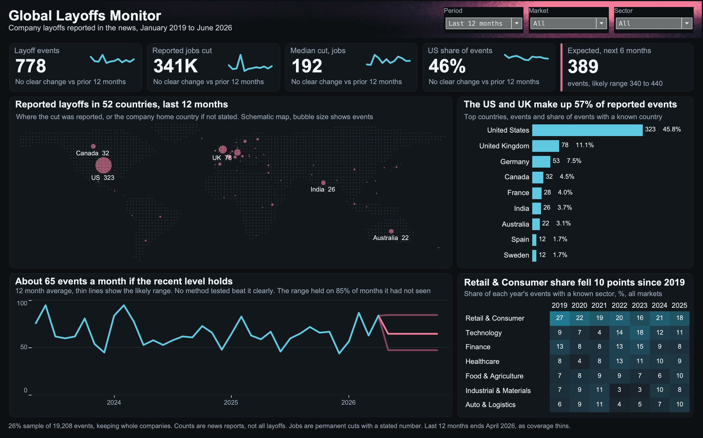

# Global Company Layoffs

The US and UK made up 57% of layoffs reported in the news over the last 12 months. This project measures where reported layoffs concentrate and what level to expect next, after testing which findings a sample built from news reports can support.

## Key results

- **57%** of reported events with a known country in the last 12 months came from the US and UK.
- **9 of 32** of the largest job figures reviewed did not describe one layoff round. Removing them cut job growth from 8.4% to 2.6%.
- **65** events a month expected in the sample, likely between 48 and 85. No method tested clearly beat the 12 month average.

**Recommendation:** use news counts as a measure of reported activity, not of all layoffs. Review the largest job figures against their source before adding them up, because a few rows can inflate a year on year change.

## Data

Source: [Layoffs Dataset 2019-2026](https://www.kaggle.com/datasets/harshitkz/layoffs-2019-2026) by Fliar Research. The Kaggle page lists CC BY-NC-SA 4.0 and the publisher's description lists CC BY-NC 4.0, so the data here is shared non-commercially under CC BY-NC-SA 4.0. The original file is in `data/raw`.

### Limits of the data

- The file is a 26% sample, 5,000 of 19,208 events, chosen by company. It is built from news, so unreported layoffs are missing and large companies and English-language media are favoured.
- The sample matches the publisher's full tables well: 25.6% to 27.1% of events each year from 2019 to 2025, and a 0.88 monthly correlation.
- A job figure is kept when the number appears in the news sentence. That does not confirm it is one new layoff round.
- May 2026 has no events from the 6th to the 31st, and the data stops on 14 June 2026. The last 12 months therefore end in April 2026.
- Country is where the cut was reported, or the company home country if not stated.
- Only the 16 largest job figures in each 12 month window were read by hand. Smaller rows may hold similar problems.

## What was tested

| Claim | Test | Result |
| --- | --- | --- |
| Events rose 3.7% | 95% interval -6% to +15% | Not clear in the sample. The publisher's full July to April tables show +7.9% |
| Jobs rose 8.4% | Hand review of the 32 largest figures | Falls to 2.6% after review |
| Median cut rose 14.7% | Bootstrap interval -20% to +39% | Not clear |
| US share rose 3.8 points | Company-level bootstrap, -1.3 to +9 points | Not clear |
| Country changes | Poisson test | None larger than chance |

The dashboard prints a change only when it is larger than chance.

## Forecast

Five methods were scored over 24 rolling starting points, six months ahead. "Same month last year" came first, but its gain over the 12 month average was not distinguishable from zero, so the simpler average is used. The range uses only errors known at each forecast date, and it held on 85% of 162 unseen months. May to October 2026 cannot be checked because coverage thins after April.

## Steps

1. `python/clean_layoffs.py` standardises countries and sectors, separates furloughs, and writes the cleaning log.
2. `python/data_audit.py` tests the sample and the headline claims, and writes the hand review to `audit_output/headcount_review.csv`.
3. `python/apply_corrections.py` reads that review, removes 9 rows, corrects a company-country linking error, and relabels one country name. Every change is in `data/corrections.csv`.
4. `python/forecast.py` runs the backtest and forecast. Its results are in `forecast_output/`.
5. `dashboard/layoffs_monitor.twbx` is the Tableau dashboard.

## Tools

Python, Excel, Tableau
